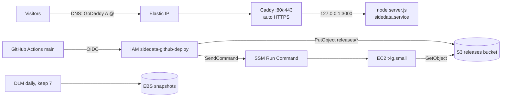

# SideData website infrastructure (AWS, single EC2)

Terraform in `infra/terraform/` hosts the Next.js standalone build on one
Graviton EC2 instance in `ca-central-1` (account `499024812515`). Nothing here
has been applied yet. Review the plan before you apply.

## Architecture

- **1x EC2 `t4g.small`**, Ubuntu 24.04 LTS arm64 (AMI from Canonical's public
  SSM parameter), in the default VPC's `ca-central-1a` subnet, with an Elastic IP.
  The root volume is 20 GB gp3, encrypted. IMDSv2 is required and termination
  protection is on.
- **Caddy** listens on :80/:443, gets Let's Encrypt certificates automatically,
  redirects `www` to the apex, and reverse-proxies to **Node 22** on
  `127.0.0.1:3000` (`sidedata.service`, systemd-hardened, user `sidedata`).
- **No SSH.** The security group allows only 80/443 in. Admin access goes through
  **SSM Session Manager**.
- **Deploys:** GitHub Actions (only `ChiragB254/SideDataa`, `refs/heads/main`)
  assumes `sidedata-github-deploy` via OIDC, uploads the build to
  `s3://sidedata-releases-499024812515/releases/`, then runs the on-box deploy
  through `ssm:SendCommand` (`AWS-RunShellScript`).
- **Backups:** daily root-volume snapshots through DLM at 07:00 UTC, keeping 7.
  Release objects expire after 60 days.
- **Alerting:** a CloudWatch `StatusCheckFailed` alarm. Notifications go out only
  if you set `alert_email`. EC2 simplified auto-recovery is on.



On-box layout (the contract with the deploy script):

| Path                                 | Purpose                                                                             |
| ------------------------------------ | ----------------------------------------------------------------------------------- |
| `/opt/sidedata/releases/<git-sha>/`  | Next standalone output (`server.js` at root, `.next/static` and `public` merged in) |
| `/opt/sidedata/current`              | symlink to the active release; the app starts only once `current/server.js` exists  |
| `/opt/sidedata/shared/`              | the only path the app can write to (`sidedata:sidedata 0750`)                       |
| `/etc/sidedata/env`                  | runtime secrets, `root:sidedata 0640`, never overwritten by bootstrap               |
| `/usr/local/sbin/sidedata-bootstrap` | idempotent bootstrap; re-run with `sudo /usr/local/sbin/sidedata-bootstrap`         |
| `/var/log/sidedata-bootstrap.log`    | bootstrap log                                                                       |

## Prerequisites (owner)

1. Terraform >= 1.9 (`brew install hashicorp/tap/terraform`), AWS CLI v2, and
   the [Session Manager plugin](https://docs.aws.amazon.com/systems-manager/latest/userguide/session-manager-working-with-install-plugin.html).
2. AWS credentials for account 499024812515 with admin rights.
   **Do not use root access keys.** The CLI on this machine currently
   authenticates as `arn:aws:iam::499024812515:root`. Create an IAM Identity
   Center user or an admin IAM user, use `aws sso login` or a profile, then
   delete the root access keys.
3. Optional: `cp infra/terraform/terraform.tfvars.example infra/terraform/terraform.tfvars`
   and set `acme_email` and `alert_email`.

## First deploy: order of operations

Do these in order. Merging to `main` before step 3 makes the Deploy workflow
fail, because it has no role to assume. That failure doesn't affect the live
site, but it is noise. Re-run the workflow after step 3.

1. **Apply** (owner runs this; review the plan first):

   ```bash
   cd infra/terraform
   terraform init
   terraform plan -out=tfplan   # read every line; expect ~28 to add (30 with alert_email), 0 to change/destroy
   terraform apply tfplan
   terraform output             # elastic_ip, instance_id, release_bucket_name, github_deploy_role_arn
   ```

2. **Wait for the bootstrap** (about 3-5 minutes: apt, Node, Caddy). The SSM
   agent can take a minute or two to register before `start-session` works.

   ```bash
   aws ssm start-session --region ca-central-1 --target "$(terraform output -raw instance_id)"
   sudo tail -f /var/log/sidedata-bootstrap.log   # wait for "sidedata bootstrap done"
   ```

3. **Set the GitHub repository variables** (Settings, Secrets and variables,
   Actions, **Variables** tab). None of these are secrets:

   | Variable                         | Value                                                             |
   | -------------------------------- | ----------------------------------------------------------------- |
   | `AWS_DEPLOY_ROLE_ARN`            | `terraform output -raw github_deploy_role_arn` (required)         |
   | `NEXT_PUBLIC_SITE_URL`           | `https://sidedataa.com`                                           |
   | `NEXT_PUBLIC_TURNSTILE_SITE_KEY` | optional; Turnstile site key (set with the secret key on the box) |
   | `RELEASE_BUCKET`                 | optional; defaults to `sidedata-releases-499024812515`            |

4. **Push or merge to `main`.** The Deploy workflow builds the site, uploads it,
   and switches the server to it.

Then put the runtime secrets on the box (below), and do DNS.

## State

State is **local** (`infra/terraform/terraform.tfstate`, gitignored). Losing
it means Terraform no longer knows these resources exist. Back the file up
somewhere private after each apply. It contains resource IDs and the rendered
user_data, but no secrets.

Recommended next step: move state to a versioned, encrypted S3 bucket with S3
native locking (`backend "s3" { use_lockfile = true }`; needs Terraform 1.10 or
later, check the current backend docs), then run `terraform init -migrate-state`.

## DNS at GoDaddy

Caddy can only get certificates after DNS points at the Elastic IP. Before
that, Caddy runs normally and keeps retrying ACME with backoff, and HTTPS
fails with a TLS error. That is expected. Once DNS resolves, a certificate
usually arrives within minutes, with no action needed.

1. GoDaddy, Domain, DNS, **DNS Records**:
   - `A`, name `@`, value = `terraform output -raw elastic_ip`, TTL 600 (1 h after launch).
   - `CNAME`, name `www`, value `sidedataa.com` (or `@`). Caddy issues the
     `www` certificate and does the 301 to the apex. **Do not** use GoDaddy
     "Forwarding" for www: www must resolve to this server.
   - **Delete** any other `A` records on `@`/`www` (GoDaddy parking) and any
     `AAAA` records. This server has no IPv6, and a stale AAAA record breaks
     ACME and some visitors.
   - If any `CAA` records exist, add `0 issue "letsencrypt.org"`.
   - Leave MX/TXT (email, Resend verification) untouched.
2. Check: `dig +short sidedataa.com A` and `dig +short www.sidedataa.com` both return the EIP.
3. Watch issuance: on the box, `journalctl -u caddy -f`.

## Secrets in `/etc/sidedata/env`

Secrets never go in Terraform, user_data, or git. Put them on the box:

```bash
aws ssm start-session --region ca-central-1 --target <instance_id>
sudo -e /etc/sidedata/env           # KEY=value lines; quote values with spaces
sudo chown root:sidedata /etc/sidedata/env && sudo chmod 0640 /etc/sidedata/env
sudo systemctl restart sidedata
```

Runtime keys: `RESEND_API_KEY`, `CONTACT_TO`, `CONTACT_FROM`,
`TURNSTILE_SECRET_KEY`. `NEXT_PUBLIC_*` values (site URL, Turnstile site key)
are inlined at **build** time, so set them as GitHub variables, not here.

The unit fixes `NODE_ENV=production`, `PORT=3000` and `HOSTNAME=127.0.0.1`
through `env(1)` in `ExecStart`. If one of them shows up in this file anyway,
it is ignored, so a stray line can't expose the app on `0.0.0.0` (verified
under systemd in an Ubuntu 24.04 container).

Note: an SSM session shell is a root-capable shell, and its input can end up in
SSM session logs if you turn session logging on later. Use `sudo -e` (an
editor) instead of `echo KEY=... >>`.

## Operating

```bash
systemctl status sidedata caddy
journalctl -u sidedata -n 200 --no-pager     # app logs
journalctl -u caddy -n 200 --no-pager        # access + TLS logs (JSON)
sudo /usr/local/sbin/sidedata-bootstrap      # re-apply server config (idempotent)
```

Patching: unattended-upgrades installs Ubuntu security updates **and** updates
from the NodeSource (`node_22.x` only, so the major version never changes) and
Caddy (Cloudsmith) repos. Caddy restarts itself on upgrade. A Node update takes
effect at the next deploy or reboot; `sudo systemctl restart sidedata` applies
it right away. To check what happened: `sudo less /var/log/unattended-upgrades/unattended-upgrades.log`.
The origin patterns were checked with an `unattended-upgrade --dry-run` on
Ubuntu 24.04 arm64, which planned upgrades for both packages (2026-10-24).
It is still worth running `sudo apt update && apt list --upgradable` once a
month as a spot check.

The app service cannot reach the instance metadata endpoint
(`IPAddressDeny=169.254.169.254 fd00:ec2::254`), so app code cannot read the
instance role credentials. Root, the SSM agent and the deploy script run
outside that unit and are unaffected. HTTP/3 is off (`protocols h1 h2`)
because the security group opens TCP 443 only.

Terraform ignores changes to `user_data` and `ami` on purpose. Without that,
every new Ubuntu AMI would replace the server. That means editing
`templates/bootstrap.sh.tftpl` does **not** touch the running box. You can
either copy the new script over SSM and re-run it, or rebuild the box
(`enable_termination_protection=false`, then
`terraform apply -replace=aws_instance.web`, which keeps the same Elastic IP;
redeploy the app afterwards).

## Rollback

The previous releases stay on disk under `/opt/sidedata/releases/`. If the
deploy workflow has a rollback command, use that. Otherwise, over SSM:

```bash
ls -1t /opt/sidedata/releases/            # newest first
readlink /opt/sidedata/current            # what is live now
SHA=<previous-git-sha>
sudo ln -sfn "/opt/sidedata/releases/$SHA" /opt/sidedata/current.new
sudo mv -T /opt/sidedata/current.new /opt/sidedata/current
sudo systemctl restart sidedata
curl -sI -H 'Host: sidedataa.com' http://127.0.0.1:3000/ | head -1
```

Restoring the whole box from a snapshot: EC2 console, Snapshots
(tag `SnapshotCreator=dlm`), Create volume in `ca-central-1a`. Then stop the
instance, detach the root volume, attach the restored volume as `/dev/sda1`,
and start. For this stateless site, rebuilding plus a redeploy is usually
simpler.

## Monthly cost estimate (ca-central-1, USD, on-demand)

Prices come from the AWS Price List API (`aws pricing get-products`), queried
2026-10-24. The month is 730 hours.

| Item                                   | Assumption                                                  | Unit price      | Monthly                                                                                   |
| -------------------------------------- | ----------------------------------------------------------- | --------------- | ----------------------------------------------------------------------------------------- |
| EC2 t4g.small Linux                    | 730 h, `cpu_credits=standard`                               | $0.0184/h       | $13.43                                                                                    |
| Public IPv4 (Elastic IP, in use)       | 730 h                                                       | $0.005/h        | $3.65                                                                                     |
| EBS gp3 root                           | 20 GB, default 3000 IOPS / 125 MiB/s (no extra provisioned) | $0.088/GB-mo    | $1.76                                                                                     |
| EBS snapshots (7 daily, incremental)   | ~6-8 GB stored total                                        | $0.055/GB-mo    | ~$0.40                                                                                    |
| S3 releases                            | < 1 GB, ~60 objects, few requests                           | $0.025/GB-mo    | < $0.10                                                                                   |
| CloudWatch alarm                       | 1 standard alarm                                            | $0.10/alarm-mo  | $0.10                                                                                     |
| Data transfer out                      | < 100 GB/mo, covered by the 100 GB/mo free tier [3]         | $0.09/GB beyond | $0.00                                                                                     |
| SSM Session Manager / Run Command, DLM | no charge on EC2 [4][5]                                     | -               | $0.00                                                                                     |
| **Total**                              |                                                             |                 | **~ $19.50/month** (before tax, and before any Free Tier credits; eligibility is unknown) |

Top cost risks:

1. **Traffic** beyond 100 GB/mo is billed at $0.09/GB (a viral post or a bot scrape).
2. **`cpu_credits=unlimited`**: surplus credits are billed at $0.04/vCPU-hour. It
   stays `standard` (throttle, no bill) unless you change it.
3. **Leftovers after teardown**: DLM snapshots are not deleted by
   `terraform destroy`, and an Elastic IP left unattached is still billed.

Sources: [1] AWS Price List API, ca-central-1 (`AmazonEC2`, `AmazonVPC`,
`AmazonS3`, `AmazonCloudWatch`, `AWSDataTransfer`; public IPv4 is usage type
`CAN1-PublicIPv4:InUseAddress`), 2026-10-24;
[3] https://aws.amazon.com/ec2/pricing/on-demand/ ("100 GB of free data transfer out to the internet free each month"), 2026-10-24;
[4] https://aws.amazon.com/systems-manager/pricing/, 2026-10-24;
[5] https://docs.aws.amazon.com/ebs/latest/userguide/snapshot-lifecycle.html ("at no additional cost"), 2026-10-24.

## Known limits and risks

- **Single point of failure.** One instance in one AZ. Host failures
  auto-recover, but an AZ outage, a bad deploy, or a full disk takes the site
  down. That trade-off is accepted for a marketing site.
- **The status-check alarm does not see app outages, or a stopped instance.**
  A crashed Node or Caddy process passes EC2 status checks. Missing data is
  treated as "not breaching" so the first apply and deliberate stops don't
  alarm, but that also means a stopped instance stays silent. Add a free
  external HTTPS uptime monitor on `https://sidedataa.com/` (or pay for
  CloudWatch Synthetics).
- **If Cloudflare (or any CDN) proxying is enabled later**, Caddy's peer becomes
  the CDN, and the app's rate limiter sees one client IP for everyone (it trusts
  the rightmost `X-Forwarded-For`, which Caddy sets to the peer). Before
  turning proxying on, revisit `lib/submission.ts` client-IP logic and Caddy
  `trusted_proxies`/`client_ip_headers`.
- **Whoever can push to `main` gets root on the server**, through SendCommand
  plus AWS-RunShellScript. Protect `main` (required reviews, no force-push) and
  restrict who has write access to the repo.
- **The OIDC subject must match exactly**: `repo:ChiragB254/SideDataa:ref:refs/heads/main`.
  A deploy job that uses `environment:`, or a renamed or transferred repo,
  fails to assume the role until `github_repo` / the trust policy is updated.
- Automatic security reboots at 08:00 UTC (about 03:00-04:00 Toronto) can cause
  about a minute of downtime when a kernel update needs it. Set
  `unattended_reboot_time = ""` to disable them (then reboot manually).
- Node 22 is in Maintenance LTS and reaches end of life on **2027-04-30**
  (nodejs/Release schedule). Plan the move to Node 24 (`node_major = 24`, then
  re-run bootstrap) before then.
- Release objects expire after 60 days. Running releases are unaffected
  because they are already on disk, but a rebuilt box needs a fresh CI deploy.

## Teardown

```bash
cd infra/terraform
terraform apply -var enable_termination_protection=false -var bucket_force_destroy=true
terraform destroy -var enable_termination_protection=false -var bucket_force_destroy=true
# DLM snapshots survive destroy and keep billing. List them, then delete:
aws ec2 describe-snapshots --region ca-central-1 --owner-ids self \
  --filters Name=tag:SnapshotCreator,Values=dlm --query 'Snapshots[].SnapshotId' --output text
# aws ec2 delete-snapshot --region ca-central-1 --snapshot-id snap-...
```

Then remove the GoDaddy A/CNAME records. The destroy also deletes the GitHub
OIDC provider. If anything else in the account uses it by then, set
`create_github_oidc_provider=false` first.
